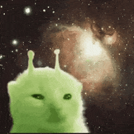
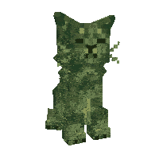

  

<h1 align="center">Hola, soy SpaceCat-2008 😼</h1>

<i>El arte empieza donde termina el cielo</i>

  
  
  

---

## Sobre mí

Estoy aprendiendo Java y me encanta llevar a cabo ideas, crear juegos y cosas que me imagino.

## Mis proyectos

### 🎮 Alien Moon Survival 2D
Pequeño proyecto de un mini juego de supervivencia en 2D.

[Ver el código](https://github.com/SpaceCat-2008/Alien-moon-survival-2D)

---

## Herramientas

---

## Contacto

⭐ Gracias por pasar por mi perfil ⭐

